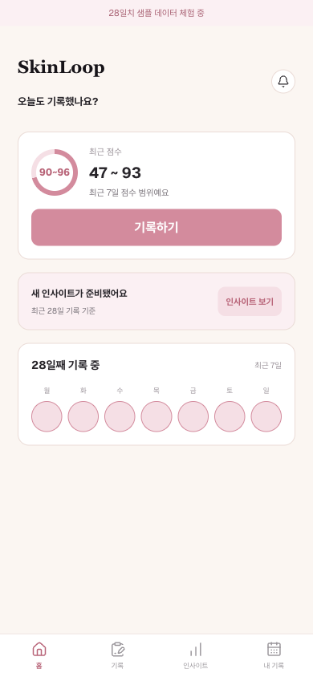
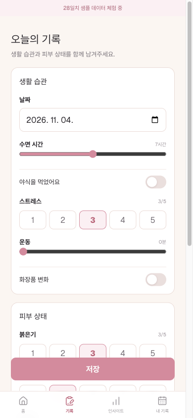
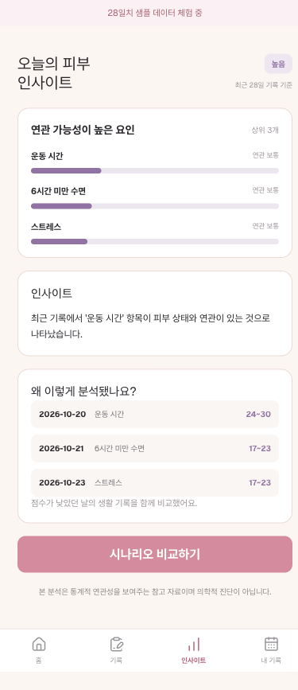
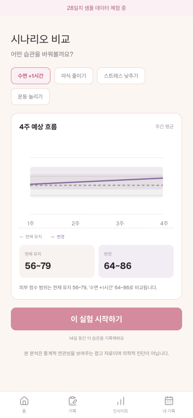

# SkinLoop

생활습관과 피부 상태를 함께 기록해 둘 사이의 연관 패턴을 찾고, 습관 하나를 바꾼 시나리오를 현재 유지와 비교해 보는 모바일 우선 웹 서비스입니다.

멋쟁이사자처럼 중앙 해커톤 팀 프로젝트로, 5일 동안 핵심 기능 3개를 개발했습니다. 해커톤용 서버는 종료되어 지금은 로컬에서 실행할 수 있습니다.

> 본 분석은 통계적 연관성을 보여주는 참고 자료이며 의학적 진단이 아닙니다.

## 핵심 기능

- **데일리 체크인**: 로그인 없이 수면·야식·스트레스·운동·화장품 변화와 붉은기·트러블·유분감을 기록합니다.
- **패턴 분석**: 기록이 7일 이상 쌓이면 피부 점수와 연관 가능성이 높은 습관을 순위로 보여줍니다.
- **시나리오 비교**: 습관 하나를 바꾼 경우와 현재를 유지한 경우의 4주 흐름을 점수 범위로 비교합니다.

## 화면

28일 샘플 데이터를 넣고 로컬에서 실행한 화면입니다.

| 홈 | 기록 | 인사이트 | 시나리오 비교 |
| --- | --- | --- | --- |
|  |  |  |  |

## 구조

```text
브라우저 ─ Caddy ─┬─ /      → skinloop-fe (Next.js)
                  └─ /api/* → skinloop-be (FastAPI) ─ PostgreSQL
                                 ├─ src/ : AI 계산 모듈(같은 프로세스에서 호출)
                                 └─ llm_formatter : 결과 문장화(OpenAI, 실패 시 규칙 기반)
```

| 경로 | 내용 |
| --- | --- |
| [`skinloop-fe/`](skinloop-fe) | Next.js 15, React 19 프론트엔드. 설치형 앱(PWA) 지원 |
| [`skinloop-be/`](skinloop-be) | FastAPI 백엔드 |
| [`skinloop-ai/`](skinloop-ai) | AI 계산 모듈, 샘플 데이터, 내부 평가 |
| [`deploy/`](deploy) | 배포 런북과 스모크 스크립트 |
| [`docs/`](docs/README.md) | 기능 명세와 작업 계획 |

## AI 모듈

계산은 통계 모델이 하고, LLM은 계산 결과를 문장으로 옮기는 일만 합니다. LLM에 없는 수치를 만들게 하지 않기 위해서입니다.

- **피부 점수**: 붉은기·트러블·유분감 입력으로 계산합니다.
- **패턴 분석**: Spearman 상관계수와 시차(lag)로 영향 가능성이 높은 습관을 찾습니다.
- **시나리오 비교**: Ridge 회귀로 습관을 바꾼 경우와 현재 유지를 비교합니다.
- **문장화**: `OPENAI_API_KEY`가 있으면 `gpt-4o`를 호출합니다. 키가 없거나 5초를 넘기거나 호출이 실패하면 규칙 기반 문장으로 대체하고, 분석 결과는 그대로 보여줍니다.

28일 합성 데이터 1개로 walk-forward 내부 평가를 한 결과, Ridge의 MAE는 4.529로 과거 평균(9.981)과 직전 점수(7.214)보다 낮았습니다. 계산 범위 안에 실제 점수가 들어간 비율은 50%였습니다. 실제 사용자 데이터에서 검증한 결과가 아니며, 자세한 내용은 [내부 평가 문서](skinloop-ai/docs/model_evaluation.md)에 있습니다.

## 실행

Docker가 필요합니다. `OPENAI_API_KEY`는 비워 둬도 동작합니다.

```bash
git clone https://github.com/KimHands/skinloop.git
cd skinloop
cp .env.example .env
docker compose up --build
```

`http://localhost`에 접속한 뒤 홈에서 **28일 샘플 보기**를 누르면 분석 화면까지 바로 볼 수 있습니다.

## 테스트

```bash
# 백엔드
cd skinloop-be && pip install -r requirements.txt && pytest

# AI 모듈
cd skinloop-ai && pip install -r requirements-dev.txt
python -m pytest
python scripts/validate_seed.py
python scripts/evaluate_model.py
```

## 내 역할

[@KimHands](https://github.com/KimHands), 백엔드 담당.

- FastAPI 백엔드 코어(세션·기록·패턴·시나리오·샘플 데이터 API)
- AI 계산 모듈의 in-process 통합과 LLM 문장화 5초 제한
- 명세에 맞춘 API 계약 수정
- Docker Compose 스택, 배포 런북, Caddy 자동 HTTPS

## 팀

[@KimHands](https://github.com/KimHands) · [@Seon-K](https://github.com/Seon-K) · [@kyeoon](https://github.com/kyeoon) · [@seoj1n23](https://github.com/seoj1n23)

`skinloop-ai/`의 커밋 이력은 별도 레포였던 [SkinLoopAI](https://github.com/KimHands/SkinLoopAI)에서 옮겨 왔습니다.
